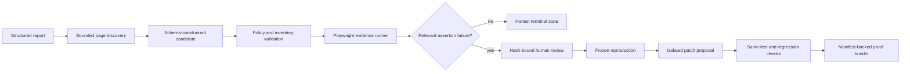

# Bug-to-Proof

> Turn a structured bug report into a constrained browser reproduction, a reviewed repair, and evidence that can be independently checked.

Bug-to-Proof is a TypeScript/React prototype built around one question: **can an AI-assisted repair workflow prove what happened instead of merely claiming success?**

For the included MiniShop application, the system discovers trusted UI targets, generates a schema-constrained Playwright candidate, pauses for hash-bound human review, records the baseline against unchanged source, verifies an isolated patch with the identical test, runs regression gates, and exports a SHA-256 manifest-backed proof bundle.

This is an evidence-engineering prototype, not an “any website, any bug” product. The verified target is the configured local MiniShop application, and provider or environment failures are never counted as reproduced product bugs.

## Why it is different

- **Constrained generation:** candidates use versioned actions and assertions. Raw CSS, XPath, JavaScript, and arbitrary selectors are rejected.
- **Discovery-bound controls:** repeated controls are addressed through identities issued by the page inventory.
- **Human approval:** the reviewed definition and compiled test are frozen and bound to SHA-256 hashes.
- **Honest lifecycle states:** only a report-relevant assertion failure on unchanged source reaches `REPRODUCED`.
- **Same-test verification:** the exact accepted test must fail before the patch and pass afterward.
- **Isolated repair:** proposed edits are applied in a contained workspace with path and diff validation.
- **Fail-closed gates:** typecheck, build, tests, provenance, and proof checks must all pass.
- **Auditable output:** proof bundles contain a versioned manifest and per-file digests.

## Verified results

The retained AR7 scorecard reports results with their denominators:

| Cohort | Result |
| --- | --- |
| Discovery-bound acceptance | 3/3 executable candidates; 2/3 relevant assertion failures |
| Human-reviewed baselines | 1/2 review-eligible failures accepted and frozen |
| End-to-end reference repair | 1/1 passed identical-test, regression, and proof checks |
| Frozen held-out reports | 2/4 valid candidates; 1/4 executable; 0/4 relevant reproductions |
| Held-out infrastructure failures | 2/4 provider-connectivity failures |

The end-to-end repair proposal was deterministic reference output. Its browser execution, unchanged-test verification, regression gates, and proof validation were real. The frozen held-out set was executed once and was not reused after a discovered locator gap was fixed.

See the [sanitized evaluation summary](docs/evidence/ar7-evaluation.md) and [current project status](docs/current-project-status.md) for the full boundary.

The latest frozen 12-bug/2-control MiniShop cohort passed 16/16 independent browser reference checks and ran once through the configured Groq endpoint. **10/12** bug reports had independently reviewed report-matched failing assertions, exceeding the predeclared 8/12 target. Eleven of twelve bug cases produced valid executable candidates; one candidate failed review, and one was blocked by a classified provider HTTP 429. Both controls avoided false reproduction. No v5 candidate has human baseline acceptance or live-model repair verification. See the [v5 live scorecard](docs/evidence/prospective-v5-live-evaluation.md), [v5 reference verification](docs/evidence/prospective-v5-reference.md), and earlier [v3](docs/evidence/prospective-v3-live-evaluation.md) and [v2](docs/evidence/prospective-v2-live-evaluation.md) historical scores; the AR7 numbers above remain historical.

A separately authorized post-evaluation retry of the HTTP-429 USB-total case produced a valid report-matched failure on the first provider request, and the identical generated test passed against fixed MiniShop. This diagnostic does not rescore the consumed cohort; the official v5 result remains 10/12. See the [USB-total diagnostic report](docs/evidence/p5-usb-retry-diagnostic.md).

## Architecture

Detailed, shareable diagrams are available in the [architecture guide](docs/architecture.md).



The API owns lifecycle persistence, discovery, candidate validation, repair orchestration, and proof export. The dashboard presents reports, review checkpoints, evidence, and final states. MiniShop is the deliberately bounded target application.

## Quick start

Requirements: Node.js 22+, npm 9+, and Chromium for browser verification.

```bash
git clone <your-repository-url>
cd bug-to-proof
npm install
cp .env.example .env
npm run dev
```

On Windows PowerShell, use `Copy-Item .env.example .env` instead of `cp`.

The development command starts:

- Dashboard: <http://localhost:5173>
- API: <http://localhost:3001>
- MiniShop: <http://localhost:5174>

Provider-backed generation is optional. Configure the documented variables in your local `.env`; never commit that file.

## Usage

1. Open the dashboard and create or select a structured bug report.
2. Start reproduction generation. The API inventories trusted routes and controls before requesting a candidate.
3. Inspect the candidate, validation result, compiled test, and retained baseline evidence.
4. Approve only an assertion failure that matches the report. Approval freezes the exact test bytes and hashes.
5. Start repair analysis, review the proposed patch, and approve or reject it.
6. Download the proof bundle only after the same-test verification and required regression gates pass.

Configured tests continue to work without an external provider. Dynamic candidate generation requires an enabled OpenAI-compatible or Ollama provider. Provider failures remain explicit lifecycle outcomes and are not treated as reproduced bugs.

## Run the checks

```bash
npm run typecheck
npm run test:unit -- --maxWorkers=1 --no-file-parallelism
npm run build
```

Additional maintenance and evaluation commands:

```bash
# Rebuild the historical AR7 scorecard from locally retained evidence
npm run arbitrary:evaluate

# Recalculate the reviewed v5 scorecard from frozen per-case records
npm run arbitrary:evaluate:score -- artifacts/arbitrary-reproduction/prospective-evaluation/v5-heldout-groq-2026-10-21

# Run the local report-to-proof verification workflow
npm run arbitrary:verify

# Inspect disposable artifact cleanup without deleting anything
npm run artifacts:clean
```

Commands that contact an external generation provider require explicit operator authorization and are intentionally documented outside the quick-start path. Generated runtime evidence stays under `artifacts/` and is excluded from Git; the repository retains sanitized summaries under `docs/evidence/`.

## Repository map

```text
apps/dashboard/       React dashboard and review UI
apps/minishop/        Configured demo target
services/api/         Express API, lifecycle, repair graph, proof export
packages/shared-types Shared contracts
tests/playwright/     Browser reproduction specifications
data/evals/           Frozen benchmark and evaluation datasets
scripts/              Evidence, evaluation, verification, and cleanup tools
docs/                 Current documentation and sanitized evidence
artifacts/            Local generated evidence (Git-ignored)
```

## Security and evidence model

- Report text is treated as untrusted data.
- Generated locators must match the sanitized discovery inventory.
- Provider output is schema-validated before compilation or execution.
- Secrets and raw provider payloads are not part of public evidence.
- Approval is bound to proposal and test hashes.
- Path containment and archive allowlists protect isolated workspaces and exports.
- Infrastructure, timeout, navigation, and selector errors remain distinct from product failures.

For implementation details, historical milestones, and exact limitations, start at the [documentation index](docs/README.md).

## Documentation

- [Documentation index](docs/README.md)
- [Current verification status](docs/current-project-status.md)
- [Sanitized AR7 evaluation](docs/evidence/ar7-evaluation.md)
- [Arbitrary-reproduction engineering ledger](docs/progress/arbitrary-bug-reproduction.md)
- [Security policy](SECURITY.md)

## License

No license has been selected yet. The source is visible for review, but reuse rights are not granted until a license is added.
