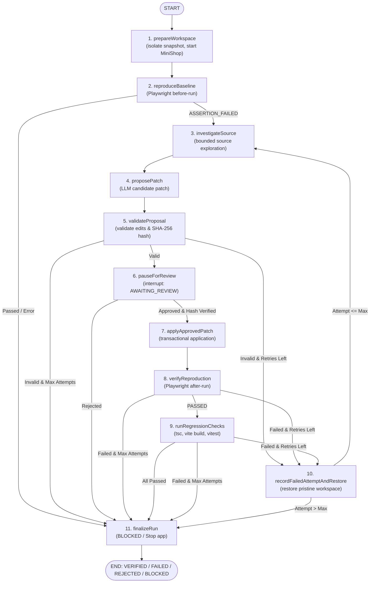

# Bug-to-Proof

> Turn a bug report into reproducible, evidence-backed proof.

**Reported → Reproduced → Failed → Patched → Verified → Proved**

---

## What is this?

Bug-to-Proof is an evidence-backed reproduction and repair prototype for the configured local MiniShop application. A new structured report can drive bounded page discovery, a schema-constrained Playwright candidate, hash-bound human review, a frozen failing baseline, isolated patch verification with the identical test, regression gates, and a SHA-256 manifest-backed Proof Bundle.

The boundary matters: this is not an “any website, any bug” system. Live generation and frozen-baseline review have been demonstrated on MiniShop. The recorded end-to-end repair uses a deterministic reference proposal; its browser execution, regression checks, and proof verification are real. The frozen four-report held-out generation set has been executed once: 2/4 produced valid candidates, 1/4 reached an executable passing baseline, 0/4 produced a relevant reproduction, and 2/4 encountered provider connectivity failures.

Start with the [documentation index](docs/README.md). For current implementation details, verification matrix, and system status, see [Current Project Status](docs/current-project-status.md).

---

## Quick Start

```bash
# 1. Clone the repo
git clone <repo-url>
cd bug-to-proof

# 2. Install all dependencies (single command for the whole monorepo)
npm install

# 3. Copy environment file (optional LLM keys)
cp .env.example .env

# 4. Start all services concurrently
npm run dev
```

This starts:
- **Dashboard**: http://localhost:5173
- **API**: http://localhost:3001
- **MiniShop (Demo App)**: http://localhost:5174

---

## Core Capabilities & Implemented Improvements

### 1. Robust Persistence & Resilient Startup
- **Atomic File Replacement**: All run and case records are written to unique temporary files and replaced atomically (`fs.renameSync`) without unsafe copy-overwrite fallback or blocking busy-waits. On failure, temporary files are unlinked and the existing record is preserved byte-for-byte.
- **Structured Error Diagnostics**: Distinguishes missing records (`404 Not Found`), invalid ID formats (`400 Bad Request`), storage contention (`503 Service Unavailable`), and corrupted files (`500 Internal Server Error`).
- **Resilient Startup Recovery**: Startup reconciliation (`recoverInterruptedRuns`) scans records individually, logs corrupt records while preserving their bytes intact for audit, and safely reconciles valid interrupted runs to `BLOCKED` while preserving `AWAITING_REVIEW` runs.

### 2. Broader Repair Benchmark (8 Diverse Cases)
The benchmark in `data/evals/repair-cases.json` includes 8 distinct cases covering:
1. `case-001-cart-total`: Calculation defect in cart item summation.
2. `case-002-repeated-item-qty`: State defect in quantity incrementing.
3. `case-003-item-removal`: State defect in item deletion.
4. `case-004-cart-clear`: State defect in checkout cart clearance.
5. `case-005-cart-total-quantities`: Calculation defect with multi-quantity items.
6. `case-006-nav-cart-count`: **UI Rendering Defect** in `App.tsx` badge rendering.
7. `case-007-promo-discount`: **Asynchronous State Defect** with promo code validation and discount calculation in `cartStore.ts`.
8. `case-008-tiered-shipping`: **Multi-File Coordinated Defect** requiring coordinated modifications across `cartStore.ts` and `Cart.tsx`.

Run the benchmark evaluation:
```bash
# Run the simulated evaluation harness across all 8 cases (100% verified)
npm run repair:evaluate -- --simulated

# Run the live browser reproduction & evaluation benchmark
npm run repair:evaluate
```

### 3. Arbitrary-report reproduction with review

- Captures steps, expected behavior, actual behavior, starting path, and context as first-class report fields.
- Discovers a bounded, sanitized inventory of MiniShop routes and controls.
- Accepts only versioned actions and assertions; raw CSS, XPath, JavaScript, and untrusted selectors are rejected.
- Keeps repeated controls unambiguous through discovery-issued `data-testid` identities.
- Freezes the exact reviewed test and binds approval to report, target, discovery, policy, definition, and compiled-test hashes.
- Counts only structured assertion failures as reproduced product bugs; provider, selector, navigation, timeout, and environment failures remain separate.

Run the retained-evidence scorecard or the local end-to-end reference:

```bash
npm run arbitrary:evaluate
npm run arbitrary:verify
npm run demo:check
```

### 4. Cryptographic Proof Bundle Export (.zip)
Every repair run can be exported as a self-contained, tamper-evident Proof Bundle (.zip):
- **Versioned Manifest (`manifest.json`)**: Contains run metadata, timestamps, and SHA-256 digests for all files.
- **Bug Case Snapshot (`case-snapshot.json`)**: Immutable snapshot of the original bug report.
- **Reproduction Spec (`reproduction/{spec}.spec.ts`)**: Exact Playwright test with verified fingerprint.
- **Baseline Evidence (`baseline/`)**: Test result, screenshots, and failure diagnostic.
- **Proposal & Review (`proposal/`)**: Diagnosis, rationale, unified diff (`patch.diff`), and approval record.
- **Verification Evidence (`verification/`)**: Post-patch test result and verification screenshots.
- **Regression Checks (`checks/`)**: Results and logs for `tsc`, `vite build`, and `vitest`.
- **Proof Report (`proof-report.md`)**: Complete human-readable verification report in GitHub Flavored Markdown.

Download via API or Dashboard:
- **API**: `GET /api/ai/repair-runs/:runId/bundle.zip`
- **Dashboard**: Click **"Download Proof Bundle (.zip)"** in the AI Repair Assistant pane.

### 5. Cross-Platform CI (Windows & Ubuntu)
GitHub Actions workflow (`.github/workflows/ci.yml`) validates the monorepo across both `windows-latest` and `ubuntu-latest`:
- Monorepo typechecking (`npm run typecheck`)
- Full unit test suite (`npm run test:unit`)
- Production Vite builds (`npm run build`)
- Benchmark simulated evaluation (`npm run repair:evaluate -- --simulated`)
- Real browser failure-to-pass workflow (`npx tsx scripts/verify-real-browser-workflow.ts`)
- Automated upload of proof and verification artifacts.

### 6. Artifact Hygiene & Safe Storage Cleanup
- **Separation of Concerns**: Curated historical evidence (`artifacts/evaluation/`, `artifacts/system-testing/`, `artifacts/portfolio-cart/`) is preserved permanently.
- **Safe Cleanup Tool**:
  ```bash
  # Dry-run inspection (default, removes nothing)
  npm run artifacts:clean

  # Execute cleanup of disposable workspace caches
  npm run artifacts:clean -- --force
  ```
  The cleanup tool automatically protects active runs, `AWAITING_REVIEW` runs, pinned runs, corrupt audit records, and curated directories.

---

## Running Verification & Tests

```bash
# 1. Run all unit and integration test suites
npm run test:unit

# 2. Run TypeScript typechecking across monorepo
npm run typecheck

# 3. Run production builds for Dashboard and MiniShop
npm run build

# 4. Run real browser failure-to-pass workflow through evidence runner
npx tsx scripts/verify-real-browser-workflow.ts

# 5. Run full simulated repair evaluation benchmark
npm run repair:evaluate -- --simulated

# 6. Rebuild the AR7 scorecard from retained evidence
npm run arbitrary:evaluate
```

---

## Architecture & Lifecycle

The dynamic repair workflow is orchestrated by **LangGraph StateGraph** (`services/api/src/ai/repair/repairGraph.ts`), coupled with durable filesystem checkpointing and exact human-in-the-loop review interruption:



---

## Evidence Integrity Gates

The verification engine enforces strict, fail-closed evidence integrity:
- **Valid Baseline Gate**: Only a recorded behavior assertion failure (`ASSERTION_FAILED` with `Expected` vs `Received` diff) qualifies as a reproduced bug. Infrastructure or syntax errors are not counted as reproductions.
- **Fingerprint Stability & Identity Binding**: Reproduction tests, reporter-format test IDs (`${specFile}:${title}:${project}`), and candidate source manifests are hashed before and after execution to prevent tampering or mutations during checks.
- **Exact Approval Binding**: Proposal approvals must supply the canonical SHA-256 hash (`proposalHash`) and `proposalId`. If source or proposal differs, application is rejected.
- **Transactional Rollback**: Patches are applied transactionally with rollback on error, preserving pristine workspace state.

---

## Project Structure

```
bug-to-proof/
├── apps/
│   ├── dashboard/          # React + Vite dashboard UI with Proof Bundle export
│   └── minishop/           # React + Vite demo app with seeded benchmark defects
├── services/
│   └── api/                # Node.js + Express API, LangGraph engine, and Proof Exporter
├── packages/
│   └── shared-types/       # Shared TypeScript contracts and interfaces
├── tests/
│   └── playwright/         # Playwright reproduction & verification specs (8 cases)
├── data/
│   ├── cases/              # Persisted JSON case files
│   └── evals/              # Repair benchmark datasets (repair-cases.json)
├── scripts/                # Evaluation, cleanup, real-browser verification scripts
├── artifacts/              # Curated evidence, proof bundles, logs, and run records
└── docs/                   # Current status page and historical audits
```
