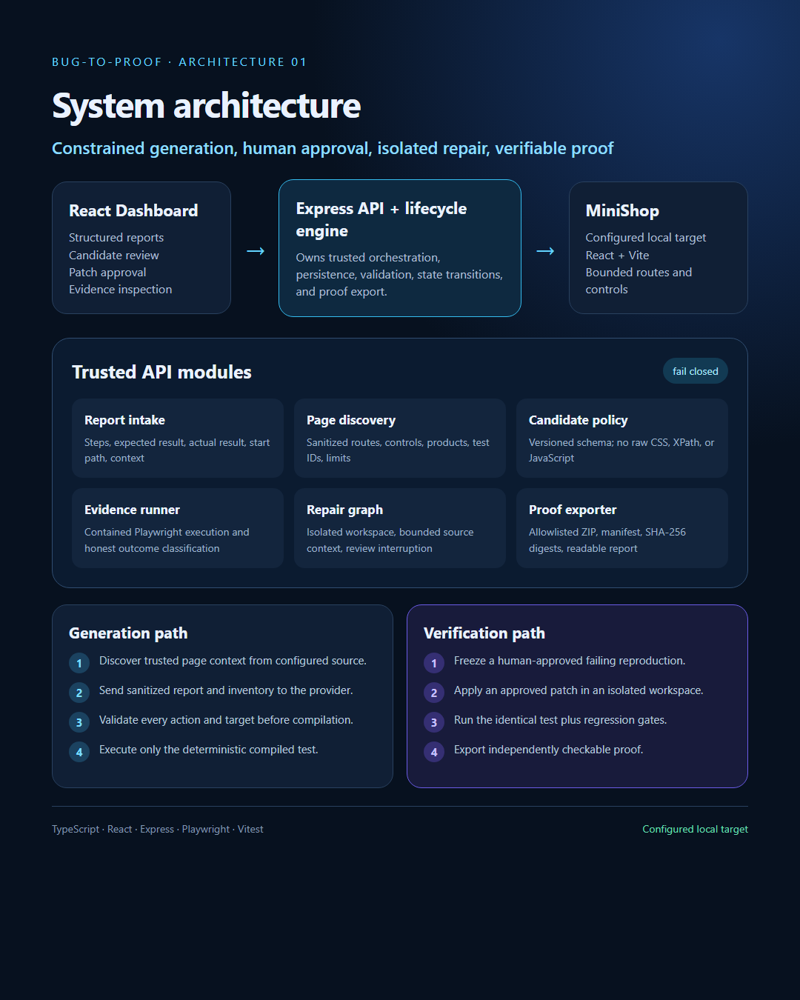
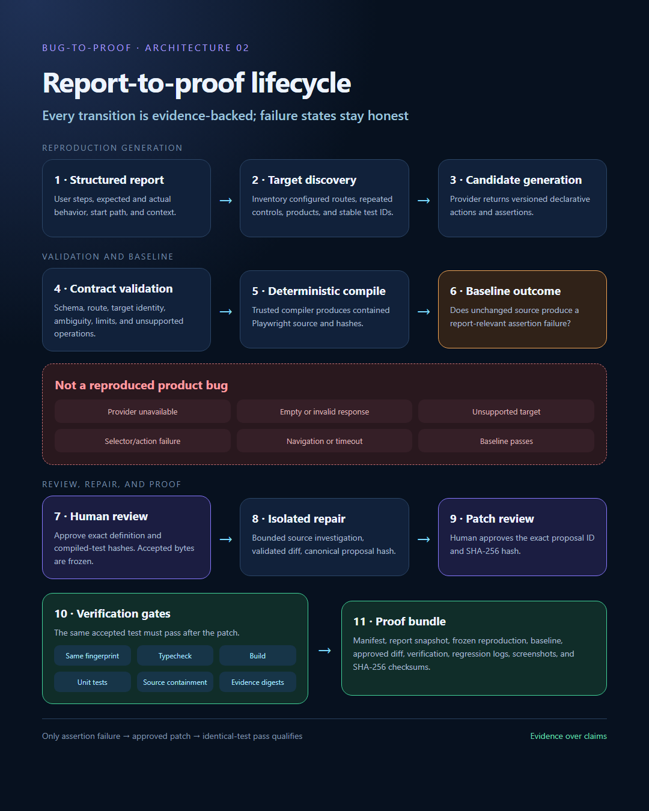
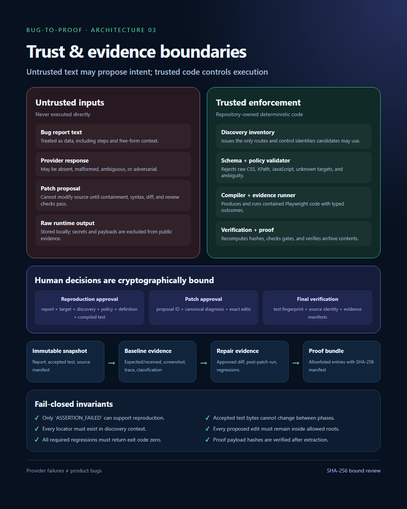

# Bug-to-Proof architecture

These diagrams describe the verified architecture for the configured local MiniShop target. They distinguish trusted code, untrusted inputs, human approval, isolated execution, and retained proof.

## System architecture

The dashboard submits reports and review decisions to the API. The API owns discovery, validation, lifecycle state, orchestration, and proof export. Generated candidates can interact only with controls present in the sanitized discovery inventory.

## Report-to-proof lifecycle

Only a report-relevant assertion failure on unchanged source may become a reproduced bug. Provider failures, invalid output, unsupported targets, navigation failures, timeouts, and infrastructure errors terminate honestly without being relabeled as product defects.

## Trust and evidence boundaries

Human decisions are bound to immutable identities. The accepted reproduction test must retain the same fingerprint before and after the patch, while the approved proposal is bound to its canonical hash. The final proof bundle independently verifies its manifest and payload digests.

## Scope

The diagrams describe the implemented local prototype, not a general-purpose arbitrary-website agent. Live reproduction generation and frozen-test review were demonstrated against MiniShop. The recorded end-to-end repair used a deterministic reference proposal; its isolated browser execution, regression checks, and proof verification were real.
